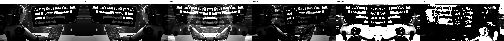
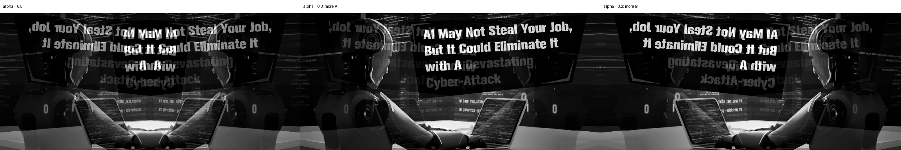
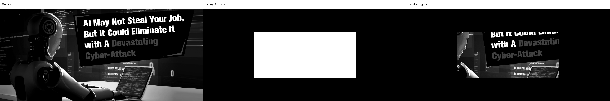
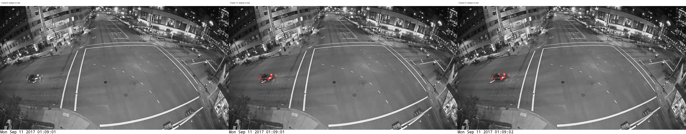

# Image Processing TP Report

**Student:** Heng Nguonhour  
**Date:** 26 October 2026  
**Topic:** Image arithmetic, noise reduction, blending, masking, and moving object detection

## 1. Objective and tools

This lab demonstrates how to process images using manual pixel-wise calculations. Each task has its own standalone Python file, from `task1.py` to `task5.py`.

NumPy arrays, arithmetic operators, indexing, comparisons, and loops implement the processing. Pillow loads and saves images and creates labeled comparison sheets. No high-level OpenCV arithmetic, blending, masking, or filtering functions are used.

## 2. Input images

Tasks 1–4 use `sample_inputs/imagefortask1-4.png`. The processed grayscale image is 768 pixels wide and 351 pixels high. Color inputs are converted manually using:

```text
Gray = 0.299 × R + 0.587 × G + 0.114 × B
```

Calculations use floating-point arrays to prevent overflow during arithmetic. For PNG output, values below 0 are set to 0 and values above 255 are set to 255 before conversion to 8-bit integers.

Tasks 1 and 3 require two images. In this implementation, A is the grayscale input and B is a horizontally flipped copy, created with NumPy indexing:

```python
b = a[:, ::-1].copy()
```

Thus, A and B have identical dimensions and format, but B is derived from A rather than a separate photograph. A separate image can be supplied with `--b`.

Task 5 uses the 22 supplied frames in `frames/`, from `frame_1000.png` to `frame_1021.png`.

## 3. Task 1 — Image arithmetic

**Source code:** [task1.py](task1.py)

### Method

For every corresponding pixel in A and B, the following calculations are performed:

| Operation | Formula |
| --- | --- |
| Addition | `R = A + B` |
| Subtraction | `R = A - B` |
| Multiplication | `R = A * B` |
| Division | `R = A / (B + 0.000001)` |

The small epsilon in division prevents division by zero. Raw results are saved as `.npy` arrays, preserving negative values and values greater than 255. The `_clipped.png` files show the same calculations restricted to the display range.

Two additional previews improve visibility: multiplication is divided by 255, and division is multiplied by 128. These display adjustments do not change the saved raw arithmetic results.

### Visual output



### Interpretation

Addition can increase brightness and saturate bright pixels. Subtraction shows positive differences; negative differences appear black in the clipped preview. Raw multiplication can exceed 255, so its clipped preview may lose detail. Division gives intensity ratios, which can be difficult to see when saved directly as 8-bit values. The scaled previews help interpret these operations.

**Results folder:** `outputs/task1/`

## 4. Task 2 — Noise reduction by averaging

**Source code:** [task2.py](task2.py)

### Method

Fifty noisy observations are generated from the same grayscale baseline. Each observation receives independent Gaussian noise with mean 0 and standard deviation 20:

```python
noisy = a + rng.normal(0, 20, a.shape)
total += noisy
average = total / 50
```

The accumulation and averaging occur before clipping. This avoids introducing clipping bias into the experiment. A fixed random seed makes the result reproducible.

### Visual output


### Measured results

Mean squared error (MSE) is calculated against the original baseline using the floating-point arrays:

```text
MSE = sum((processed - baseline)²) / number_of_pixels
```

| Measurement | Value |
| --- | ---: |
| Number of observations | 50 |
| MSE of the first noisy observation | 400.9282 |
| MSE of the averaged image | 7.9965 |
| Expected noise variance in one observation | 400 |
| Expected noise variance after averaging | 8 |

The averaged image has approximately 50 times lower MSE than the first noisy observation. This agrees with the expected reduction in independent noise variance from `σ²` to `σ²/N`.

These values are recorded in [metrics.txt](outputs/task2/metrics.txt). They describe the unclipped calculations; saved PNGs also include clipping and integer conversion.

**Results folder:** `outputs/task2/`

## 5. Task 3 — Transparency and blending

**Source code:** [task3.py](task3.py)

### Method

Each output pixel is calculated using a weighted average:

```text
R = α × A + (1 - α) × B
```

| Alpha | Contribution of A | Contribution of B | Output |
| --- | ---: | ---: | --- |
| 0.5 | 50% | 50% | `balanced.png` |
| 0.8 | 80% | 20% | `more_A.png` |
| 0.2 | 20% | 80% | `more_B.png` |

### Visual output



### Interpretation

The balanced output gives equal weight to the original and flipped images. Increasing alpha emphasizes A; decreasing alpha emphasizes B. Since the inputs are aligned arrays of the same dimensions, the formula can be applied directly to every corresponding pixel.

**Results folder:** `outputs/task3/`

## 6. Task 4 — Masking and region isolation

**Source code:** [task4.py](task4.py)

### Method

A binary mask is initialized with zeros. Its central rectangle is assigned 1:

```python
mask = np.zeros((h, w), dtype=np.float64)
mask[h//4:3*h//4, w//4:3*w//4] = 1
result = a * mask
```

The rectangle covers approximately the middle half of the image width and height. Multiplication preserves pixels inside the ROI and sets pixels outside it to zero. The saved mask displays 1 as white (255) for visibility; the calculation itself uses only 0 and 1.

### Visual output



### Interpretation

The central region retains its original grayscale values, while the surrounding region becomes black. This demonstrates region isolation through multiplication without a built-in masking function.

**Results folder:** `outputs/task4/`

## 7. Task 5 — Moving object detection

**Source code:** [task5.py](task5.py)

### Method

The supplied frames are sorted in numerical order. For each frame after the first, motion is estimated from its difference with the preceding frame:

```text
D = |current_frame - previous_frame|
M = 1 where D > 25, otherwise 0
```

Absolute differences are computed using subtraction and NumPy comparisons. A manual 3 × 3 majority filter removes isolated detections: a pixel remains active when at least five of the nine neighborhood pixels are active. The neighborhood counts are accumulated using loops and array slices.

For each frame, the program saves the difference image, binary mask, isolated changed pixels, and an overlay marking detected changes in red. The first frame has an empty mask because no preceding frame is available.

### Visual output



### Observations

The red detections mark changing areas around the vehicle in the intersection. All 22 frames were processed. After the initial frame, the number of detected pixels ranges from 484 to 606 per frame. The final frame contains 536 detected pixels.

The counts are saved in [motion_counts.csv](outputs/task5/motion_counts.csv), and [INPUTS.txt](outputs/task5/INPUTS.txt) records the use of the supplied `frames` folder.

Frame differencing detects changes rather than a complete object silhouette. It can mark both the previous and current positions of an object, and it does not continue detecting objects after they stop moving. Camera movement and lighting changes can also produce detections. This method is most suitable for a fixed camera with relatively stable lighting.

**Results folder:** `outputs/task5/`

## 8. Running the project

Run these commands from the project folder. On a fresh setup, create the virtual environment and install the dependencies once:

```sh
python3 -m venv .venv
./.venv/bin/python -m pip install -r requirements.txt
```

Run each task separately:

```sh
./.venv/bin/python task1.py
./.venv/bin/python task2.py
./.venv/bin/python task3.py
./.venv/bin/python task4.py
./.venv/bin/python task5.py --frames frames
```

The `--frames frames` argument selects the supplied video frames. Omitting it runs Task 5 with synthetic demo frames instead.

## 9. Submission contents

Include the following files and folders together so the report's image links work:

```text
Image_lab1/
├── heng_nguonhour.md
├── task1.py
├── task2.py
├── task3.py
├── task4.py
├── task5.py
├── requirements.txt
├── README.md
├── sample_inputs/
│   └── imagefortask1-4.png
├── frames/
│   └── frame_1000.png ... frame_1021.png
└── outputs/
    ├── task1/
    ├── task2/
    ├── task3/
    ├── task4/
    └── task5/
```

The `.venv` directory and the earlier combined `lab.py` are not needed in the submission. In VS Code, open this report and use **Markdown: Open Preview** to view the embedded result images.
